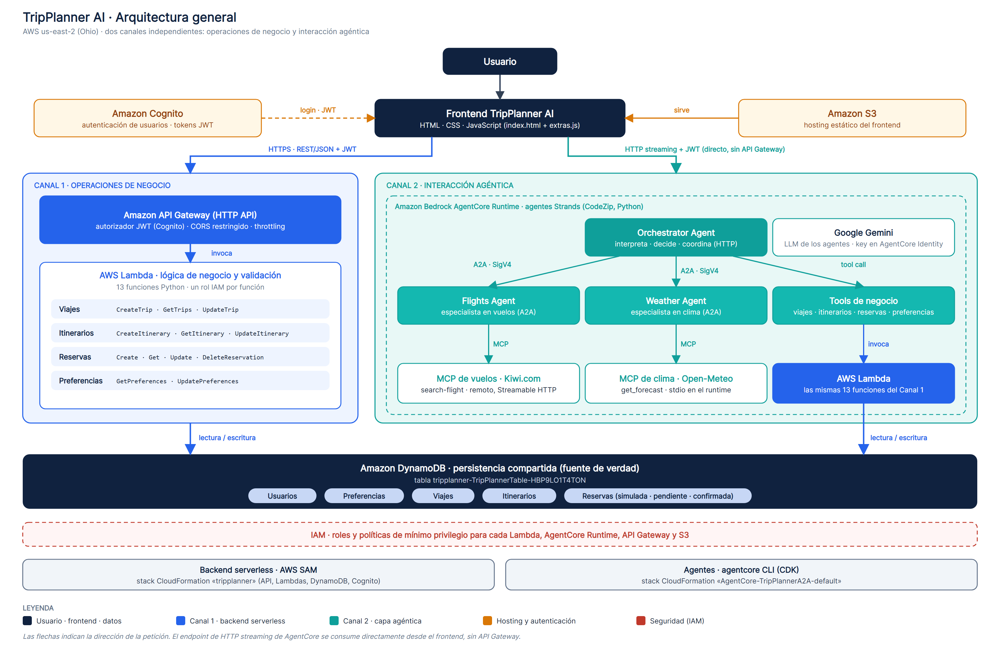
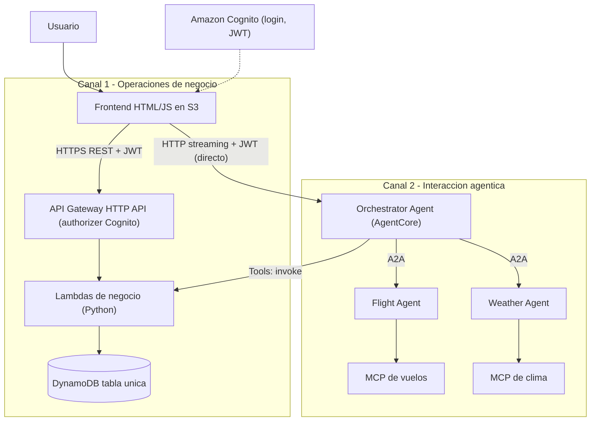

# TripPlanner AI — Trabajo final de Programación Agéntica

Plataforma web para planificar y gestionar viajes. Mantiene la arquitectura multiagente original
(Orchestrator, Flight y Weather con Strands Agents sobre Amazon Bedrock AgentCore) y agrega
frontend, backend serverless y persistencia en DynamoDB.

## 1. Arquitectura





**Componentes**

| Componente | Responsabilidad |
|---|---|
| Frontend (HTML/CSS/JS, S3) | Experiencia de usuario; renderiza tarjetas a partir del JSON de los agentes |
| Cognito | Registro e inicio de sesión; emite el JWT (IdToken) |
| API Gateway (HTTP API) | Expone las operaciones de negocio, valida el JWT, CORS restringido y throttling |
| Lambdas | Lógica de negocio y validación |
| DynamoDB | Fuente de verdad de viajes, itinerarios, reservas y preferencias |
| AgentCore + Strands | Ejecución y coordinación de los tres agentes |
| MCP | Herramientas especializadas de vuelos y clima (dentro de los agentes especialistas) |
| IAM | Un rol de mínimo privilegio por Lambda y por agente |

**Decisiones de diseño**

- **Dos canales independientes.** El streaming va directo del navegador a AgentCore, sin API Gateway.
- **Tabla única en DynamoDB.** Todo se consulta por usuario con `Query` y `begins_with`; una sola tabla simplifica permisos y costos.
- **El usuario nunca lo decide el modelo.** En las Lambdas sale del claim `sub` del JWT; en el Orchestrator, de la identidad del token, y las Tools reciben el `user_id` por código (no como parámetro del LLM).
- **Candado de escritura.** Las Tools que guardan o modifican solo se ejecutan si el mensaje del usuario pide guardar; así el agente no escribe en la base de datos por iniciativa propia.
- **Salida estructurada.** El Orchestrator responde con un resumen breve y bloques ```json (`flights`, `weather`, `trips`, `itinerary`, `reservations`) que el frontend convierte en componentes.
- **Reservas simuladas pero persistentes.** Estado por defecto `SIMULADA`.

## 2. Modelo de datos

Tabla única `TripPlannerTable` (PAY_PER_REQUEST), clave `PK` (hash) + `SK` (range).

| PK | SK | Contenido |
|---|---|---|
| `USER#<sub>` | `TRIP#<tripId>` | destination, origin, start_date, end_date, travelers, budget, notes, created_at, updated_at |
| `USER#<sub>` | `ITIN#<tripId>` | days: lista de `{date, activities:[{time, title, description}]}` |
| `USER#<sub>` | `PREF` | preferred_activities, budget_level (ECONOMICO, MEDIO, ALTO), restrictions, notes, updated_at |
| `USER#<sub>` | `RES#<tripId>#<resId>` | type (VUELO, HOTEL, ACTIVIDAD), title, provider, price, date, details, status |

**Estados de reserva:** `SIMULADA` (por defecto), `PENDIENTE`, `CONFIRMADA`. La interfaz los muestra como etiquetas «Simulada», «Pendiente» y «Confirmada».

**Patrones de acceso:** viajes del usuario (`Query PK`, `begins_with TRIP#`); un viaje (`GetItem`); itinerario de un viaje (`GetItem ITIN#tripId`); preferencias (`GetItem PREF`); reservas del usuario (`begins_with RES#`); reservas de un viaje (`begins_with RES#tripId#`).

El usuario se identifica por el `sub` de Cognito (no se guarda un registro de perfil aparte).

## 3. APIs

Base: `https://<api-id>.execute-api.<region>.amazonaws.com`. Todas exigen `Authorization: Bearer <IdToken de Cognito>`.

| Método | Ruta | Descripción |
|---|---|---|
| POST | `/trips` | Crear viaje |
| GET | `/trips` | Listar viajes |
| GET | `/trips/{tripId}` | Consultar un viaje |
| PUT | `/trips/{tripId}` | Actualizar viaje |
| POST | `/trips/{tripId}/itinerary` | Crear itinerario |
| PUT | `/trips/{tripId}/itinerary` | Reemplazar itinerario |
| GET | `/trips/{tripId}/itinerary` | Consultar itinerario |
| POST | `/trips/{tripId}/reservations` | Crear reserva |
| GET | `/trips/{tripId}/reservations` | Reservas de un viaje |
| GET | `/reservations` | Todas las reservas del usuario |
| PUT | `/trips/{tripId}/reservations/{reservationId}` | Actualizar reserva o estado |
| DELETE | `/trips/{tripId}/reservations/{reservationId}` | Eliminar reserva |
| GET | `/preferences` | Consultar preferencias del usuario |
| PUT | `/preferences` | Guardar o actualizar preferencias |

**Cuerpo de ejemplo (POST /trips):** `{"destination":"Cartagena","origin":"Bogota","start_date":"2026-12-10","end_date":"2026-12-14","travelers":3,"budget":5000000}`

**Errores:** `400` validación (mensaje claro), `401` sin token válido, `404` recurso inexistente o de otro usuario, `500` error interno sin detalles. Formato: `{"error": "mensaje"}`.

**Protección:** authorizer JWT de Cognito, CORS limitado al origen del frontend, throttling (10 req/s, ráfaga 20).

## 4. Lambdas

Un único código (`src/app.py`), una función por operación. Validaciones: tipos y rangos (viajeros 1–20, presupuesto ≥ 0), fechas ISO `YYYY-MM-DD`, `end_date ≥ start_date`, tipos y estados permitidos, longitud de textos y lista blanca de campos (nunca se guardan campos arbitrarios, por ejemplo datos de tarjeta).

| Lambda | Operación | Permisos IAM (mínimos) |
|---|---|---|
| CreateTripFn | crear viaje | escritura en la tabla |
| GetTripsFn | listar/consultar viajes | lectura |
| UpdateTripFn | actualizar viaje | lectura + escritura |
| CreateItineraryFn | crear itinerario | lectura + escritura |
| UpdateItineraryFn | modificar itinerario | lectura + escritura |
| GetItineraryFn | consultar itinerario | lectura |
| CreateReservationFn | crear reserva | lectura + escritura |
| GetReservationsFn | consultar reservas | lectura |
| UpdateReservationFn | actualizar reserva | lectura + escritura |
| DeleteReservationFn | eliminar reserva | lectura + `dynamodb:DeleteItem` |
| GetPreferencesFn | consultar preferencias | lectura |
| UpdatePreferencesFn | guardar preferencias | escritura |

Control de acceso: toda clave incluye `USER#<sub>`, de modo que cada usuario solo alcanza sus propios datos.

## 5. Tools del agente

Definidas en `app/OrchestratorAgent/trip_tools.py`. Cada Tool invoca su Lambda (`lambda:InvokeFunction`).

| Tool | Lambda |
|---|---|
| create_trip | CreateTripFn |
| get_trips | GetTripsFn |
| update_trip | UpdateTripFn |
| create_itinerary | CreateItineraryFn |
| update_itinerary | UpdateItineraryFn |
| get_itinerary | GetItineraryFn |
| create_reservation | CreateReservationFn |
| get_reservations | GetReservationsFn |
| update_reservation | UpdateReservationFn |
| get_preferences | GetPreferencesFn |
| update_preferences | UpdatePreferencesFn |

Además, `ask_flights` y `ask_weather` delegan en los agentes especialistas por A2A.

## 6. Integración de agentes

- **Streaming:** el frontend hace `POST` al endpoint de invocación del runtime del Orchestrator con el JWT en `Authorization` y un `X-Amzn-Bedrock-AgentCore-Runtime-Session-Id` por sesión. La respuesta llega por SSE como líneas `data: "<fragmento>"`; el frontend las concatena, muestra el texto en vivo y, al terminar, extrae los bloques ```json para dibujar las tarjetas.
- **Contexto de la conversación:** el frontend envía los últimos 6 mensajes (campo `history`) en cada petición y el Orchestrator los antepone al mensaje actual. El candado de escritura evalúa solo el mensaje actual, por lo que una frase anterior no autoriza guardar nada.
- **Autenticación del runtime:** el Orchestrator usa autorizador JWT (Cognito, `allowedAudience` = client id) y lee el `sub` del token.
- **Orchestrator → especialistas:** `bedrock-agentcore:InvokeAgentRuntime` con protocolo A2A (firmado con IAM). Flight y Weather consultan sus MCP.
- **Orchestrator → negocio:** Tools que invocan Lambdas; el `user_id` lo inyecta el código.

**Limitaciones conocidas:** no se usa aún la memoria gestionada de AgentCore (el contexto se mantiene enviando el historial reciente en cada petición); los precios de vuelos vienen en EUR de la fuente; la fuente de clima no siempre entrega todos los días ni la probabilidad de lluvia (se muestra «s/d»).

### Weather Agent y MCP de clima
El Weather Agent obtiene datos reales mediante un servidor MCP de clima
(`open-meteo-mcp`, basado en Open-Meteo, sin API key). El servidor se ejecuta como
subproceso (transporte stdio) dentro del runtime de AgentCore y el agente lo consume
con el cliente MCP nativo de Strands (`MCPClient`).

Las herramientas MCP se descubren en tiempo de ejecución (`tools/list`). El agente usa
`get_current_weather` y `get_current_datetime`, y una herramienta propia
`get_forecast` que invoca `get_weather_byDateTimeRange` y resume la respuesta horaria
en un pronóstico diario (mínima, máxima, humedad, probabilidad y total de lluvia),
convirtiendo las fechas de UTC a hora de Colombia. Así el modelo recibe poco texto y
no inventa datos. Si el MCP no está disponible, el agente lo informa en lugar de
simular valores.

Limitación: Open-Meteo solo ofrece pronóstico para los próximos ~16 días.

## 7. Instrucciones de ejecución (desde cero)

Requisitos: AWS CLI configurado, SAM CLI, Docker Desktop, Node.js, AgentCore CLI y una API key de Gemini.

1. **Backend** (`tripplanner-backend/`):
   ```powershell
   sam build --use-container
   sam deploy --guided   # stack: tripplanner
   ```
   Guardar los Outputs: `ApiUrl`, `UserPoolId`, `UserPoolClientId`, `TableName`.
2. **Agentes** (`TripPlannerA2A/`): en `agentcore/aws-targets.json` poner la cuenta y región; en `agentcore/agentcore.json` poner el `discoveryUrl` y `allowedAudience` del Cognito del paso 1 y los ARN de Flights y Weather; luego `agentcore deploy` (credencial Gemini manual).
3. **Permisos del Orchestrator:** añadir al rol del runtime una política con `lambda:InvokeFunction` sobre `tripplanner-*`, `cloudformation:DescribeStackResources` sobre el stack `tripplanner` y `bedrock-agentcore:InvokeAgentRuntime` sobre los runtimes.
4. **Frontend** (`tripplanner-frontend/`): en `index.html` configurar `clientId`, `api` y `agentArn`; crear un bucket S3 con hosting estático y política de lectura pública; `aws s3 sync . s3://<bucket>`; volver a desplegar el backend con `AllowedOrigin=http://<bucket>.s3-website.<region>.amazonaws.com`.
5. **Usuario de prueba:** `aws cognito-idp sign-up` y `admin-confirm-sign-up`.
6. **Prueba:** abrir la URL del bucket y ejecutar el escenario de Cartagena: vuelos y clima, «crea mi viaje», «genera el itinerario», «registra una reserva simulada», cerrar sesión y volver a entrar.

## Seguridad

IAM de mínimo privilegio por Lambda y agente; sin credenciales AWS en el navegador; validación en Lambda; control de acceso por usuario; JWT en API Gateway y en el runtime; CORS restringido; throttling; errores sin detalles internos; sin datos de tarjeta; `.env.local` fuera del repositorio.